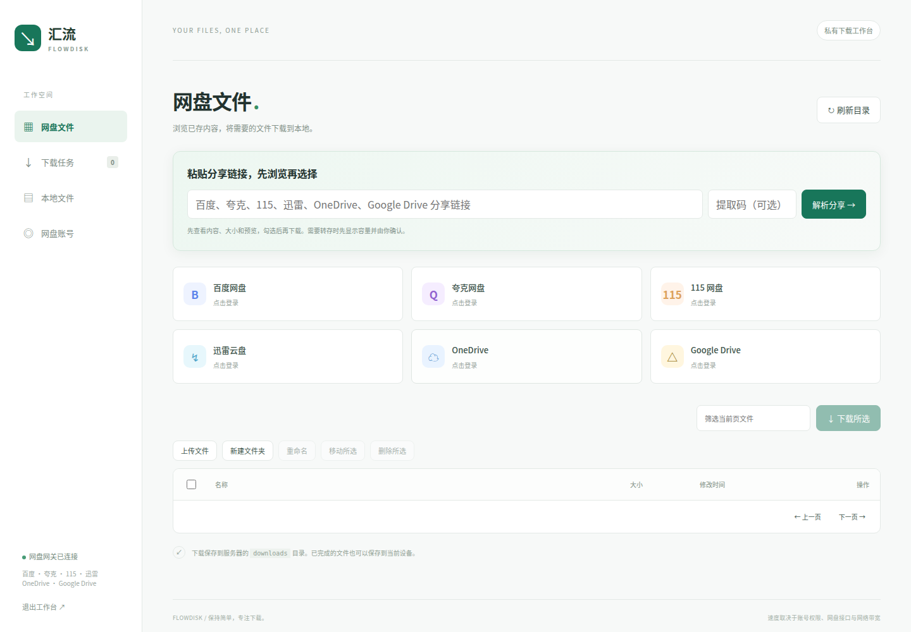

# 汇流 FlowDisk

[](LICENSE)

FlowDisk 是使用 Rust 开发、通过 Docker 部署的聚合下载工具。一个中文桌面 Web 工作台，集中管理网盘、SMB 共享、普通下载链接和 BitTorrent 任务。

## 可以做什么

- **连接网盘与共享**：百度网盘、夸克、115、迅雷云盘、OneDrive、Google Drive，以及多个 SMB 共享。
- **官方账号登录**：支持短信、扫码及已有授权，具体方式取决于网盘；OneDrive 默认使用无需公网回调的设备码，Google Drive 使用官方网页登录，可通过仅在授权期间连接的 Cloudflare 隧道接收回调。
- **先看内容再下载**：解析网盘分享链接，浏览目录、查看文件大小、搜索和筛选，预览图片、音频、视频、文本及渲染后的 Markdown，勾选文件或文件夹下载。
- **管理各种下载**：HTTP、HTTPS、FTP 链接、磁力链接和种子文件统一进入任务列表；也可从静态 HTML 页面提取链接后选择下载。
- **多连接与续传**：支持 Range 的来源可分段并发下载，暂停、断流或重启后保留进度；成品文件可通过网页下载到自己的设备，并支持 Range 续传。
- **整理任务与文件**：按分享、目录或批次分组并折叠；批量下载默认创建本地批次文件夹，也可取消。本地文件支持目录浏览、新建文件夹、重命名和直接选择目标移动；网盘及 SMB 文件支持上传、新建文件夹、重命名、移动和删除，具体取决于账号或共享权限。
- **控制带宽与做种**：设置总下载上限、BT 上传上限，以及按分享率或时长停止做种。
- **查看进度与统计**：实时、峰值、平均速度，Steam 风格速度曲线，预计剩余时间和完成时刻，累计与每日流量、任务分布、节点及分片状态、磁盘可用空间。
- **通过 MCP 操作**：让支持 HTTP MCP 的客户端查询文件、解析分享、创建和控制任务、查看统计及调整限速。



## 部署与启动

准备 Docker、Docker Compose、POSIX shell 和 `openssl`，执行：

```sh
git clone https://github.com/HosisoraLing/flowdisk.git
cd flowdisk
chmod +x setup.sh
./setup.sh
docker compose up -d --build
```

1. 打开 <http://127.0.0.1:8080>。
2. 使用项目目录 `.env` 中的 `APP_TOKEN` 进入工作台。
3. 在“网盘账号”连接账号，或在“首页”的“下载链接”输入框添加普通链接和 BT 任务。

`setup.sh` 生成随机访问凭据和数据目录，已有 `.env` 会保留。Rust 负责工作台和网盘下载，OpenList 提供部分网盘与 SMB 驱动，独立的 aria2 处理普通链接与 BT；Docker 会准备这些组件。

常用维护命令：

```sh
docker compose logs --tail=100 downloader
docker compose restart downloader
docker compose down
```

### 局域网与远程访问

默认工作台和 OpenList 管理端口仅绑定本机。在 `.env` 中设置 `BIND_IP` 为服务器局域网地址，执行以下命令后，通过 `http://服务器地址:8080` 访问：

```sh
docker compose up -d --force-recreate downloader
```

远程部署也可使用 SSH 转发：

```sh
ssh -L 8080:127.0.0.1:8080 -L 5244:127.0.0.1:5244 user@server
```

工作台通过 HTTPS 访问时，可设置 `COOKIE_SECURE=true`。如果工作台仍使用内网 HTTP、只有授权回调使用 HTTPS，则保留 `COOKIE_SECURE=false`，避免浏览器无法保存工作台登录状态。`PUBLIC_URL` 用于生成授权回调地址，可以指向独立的授权域名，不必公开工作台。

保管好 `.env`、授权数据和访问令牌；同一部署供一个可信用户使用，不提供多用户账号隔离。

## 连接网盘

进入“网盘账号”，选择网盘和登录方式。登录完成后会验证账号并建立挂载；解析分享时尚未登录，会提示先连接对应账号。

| 网盘 | 登录方式 | 分享使用方式 |
| --- | --- | --- |
| 百度网盘 | 扫码、本人 Cookie；可选自建应用 OAuth 或已有刷新令牌 | 扫码或 Cookie 账号可解析、转存分享后选择下载；OAuth 账号先在官方网盘保存分享，再从文件列表下载 |
| 夸克 | 手机验证码、扫码、已有授权 | 解析分享及子目录链接，确认转存后选择下载 |
| 115 | 扫码、已有 Cookie | 建立分享挂载，浏览并选择下载 |
| 迅雷云盘 | 手机验证码、扫码、已有刷新令牌 | 解析分享及提取码，确认转存并等待完成后选择下载 |
| OneDrive | 官方设备码登录、可选网页 OAuth、已有刷新令牌 | 读取有权访问的个人、组织及 SharePoint 分享，无需转存 |
| Google Drive | 直接官方 OAuth、已有刷新令牌 | 读取文件及文件夹分享，无需转存 |

夸克短信使用官方表单，需要浏览器可以访问官方验证资源。迅雷短信在工作台填写手机号，点击“获取验证码”后输入短信登录；打开弹窗不会自动发送短信。需要官方安全验证时，按界面提示由本人完成。

百度没有独立的手机验证码表单；配置自建 OAuth 应用后，可在百度官方授权页按其提示选择短信或扫码。115 当前没有手机验证码入口。115、迅雷扫码以及 OneDrive / Google Drive 的真实账号下载仍需本人验证。

连接账号、挂载和高级配置也可在 <http://127.0.0.1:5244> 管理，用户名为 `admin`，密码为 `.env` 中的 `OPENLIST_PASSWORD`。更改管理密码后，同步更新 `.env` 并重建下载器容器。退出或更换有活动下载的账号前，需要先暂停相关任务。

### OneDrive：设备码登录

首次使用需要自行注册微软应用；FlowDisk 不附带预配置的微软或 Google 应用凭据。

1. 在微软应用后台选择支持所需个人 / 组织账号的类型，启用“允许公共客户端流”，添加 Microsoft Graph 委托权限 `Files.ReadWrite.All` 和 `offline_access`。
2. 打开“网盘账号 → OneDrive → 设备码登录”，在应用配置中填写客户端 ID，保存。
3. 打开工作台给出的微软官方登录页，输入显示的短码，登录并允许授权。
4. 返回工作台等待自动连接，即可浏览文件和提交下载。

[设备码登录](https://learn.microsoft.com/en-us/entra/identity-platform/v2-oauth2-device-code)不需要公网 IP、域名、回调地址、端口映射或客户端密钥。FlowDisk 部署在 Linux 服务端时，也可在另一台电脑或 Android 设备上完成官方登录。组织管理员仍可能禁止设备码或限制应用授权。

### Google Drive：官方网页登录

1. 在 Google 应用后台启用 Drive API，配置同意屏幕；处于测试状态时，将自己的账号加入测试用户。
2. 创建类型为“Web 应用”的 OAuth 客户端，配置 `https://www.googleapis.com/auth/drive` 权限，取得客户端 ID 和密钥。
3. 打开“网盘账号 → Google Drive → 官方网页登录”，填写客户端 ID、密钥和授权回调 HTTPS 地址，例如 `https://auth.example.com`。
4. 将表单显示的完整回调地址 `https://auth.example.com/oauth/google/callback` 登记到 Google 应用后台的“已获授权的重定向 URI”，两处必须一致。
5. 保存配置，点击官方授权页链接，登录并允许授权。工作台会自动连接，无需跳转 OpenList 授权助手或手动复制刷新令牌。

[Google 网页授权](https://developers.google.com/identity/protocols/oauth2/web-server)需要可访问的 HTTPS 回调域名，不能直接使用局域网 IP；本机 localhost 可用于测试。工作台本身可继续使用内网地址，没有公网 IP 时可按下文配置按需隧道。

OneDrive 也可切换“官方网页登录”，填写对应应用的客户端 ID、密钥及回调 HTTPS 地址，并登记表单显示的 `/oauth/onedrive/callback` 回调。设备码登录不需要这些网页回调配置。

在工作台保存应用配置后立即生效，重启后仍保留。配置保存在服务器数据目录的 `oauth-clients.json`，密钥不回显；不要提交到 Git。使用同一客户端时，密钥留空会保留已保存的值；更换客户端时需重新填写对应密钥。已有令牌导入默认使用自己的应用，只有兼容旧 OpenList 令牌时才手动选择相应来源。

### 环境变量与可选百度 OAuth

也可通过 `.env` 提供应用配置，修改后执行 `docker compose up -d downloader` 应用。工作台中保存的配置优先于环境变量：

| 网盘 | 环境变量 | 回调地址 |
| --- | --- | --- |
| 百度 | `BAIDU_CLIENT_ID`、`BAIDU_CLIENT_SECRET` | `PUBLIC_URL/oauth/baidu/callback` |
| OneDrive 设备码 | `ONEDRIVE_CLIENT_ID` | 不需要 |
| OneDrive 网页授权 | `ONEDRIVE_CLIENT_ID`、`ONEDRIVE_CLIENT_SECRET` | `PUBLIC_URL/oauth/onedrive/callback` |
| Google Drive | `GOOGLE_CLIENT_ID`、`GOOGLE_CLIENT_SECRET` | `PUBLIC_URL/oauth/google/callback` |

`PUBLIC_URL` 填写授权回调的外部地址，例如 `https://auth.example.com`，不是带 `/oauth/.../callback` 的完整路径。百度通常直接扫码即可；使用自建 OAuth 时，应用需开通网盘权限。

标准 Compose 已配置网关与下载器之间的授权刷新连接。自定义容器网络时，可用 `FLOWDISK_INTERNAL_URL` 指定网关可访问的下载器内部地址，默认 `http://downloader:8080`；不要将其改为仅转发回调的公网域名。

OneDrive 目前接入国际版。Google 原生在线文档和快捷方式需先在官方页面导出为普通文件。组织策略、分享权限和官方安全验证仍适用。

如果部署网络需要代理，在 `.env` 设置 `CLOUD_HTTPS_PROXY`、可选的 `CLOUD_HTTP_PROXY` 和 `CLOUD_NO_PROXY`。代理地址须能从容器内访问，不能用容器内的 `127.0.0.1` 指代宿主机；默认跳过 OpenList 内网请求。

### 没有公网 IP：仅在授权期间开启隧道

可以使用独立的 [Cloudflare Tunnel](https://developers.cloudflare.com/cloudflare-one/networks/connectors/cloudflare-tunnel/)，为官方网页登录提供固定 HTTPS 回调域名。无需公网 IP、入站端口映射或付费证书；[Cloudflare Universal SSL](https://developers.cloudflare.com/ssl/edge-certificates/universal-ssl/) 会自动签发和续期证书。使用自己已有并接入 Cloudflare 的域名即可，临时 Quick Tunnel 的域名会变化，不适合登记固定回调。

1. 创建一个仅用于 FlowDisk 授权、使用本地配置文件的命名隧道，将固定授权子域名的 DNS 记录指向该隧道。不要复用承载其他服务、需要一直运行的隧道。
2. 将隧道凭据保存到宿主机 `data/flowdisk/oauth-tunnel/credentials.json`。参考 [配置示例](docs/oauth-tunnel.example.yml) 创建同目录的 `config.yml`，填写隧道 ID 和授权子域名。凭据及配置需允许容器运行用户读取，不要提交到 Git。
3. 在 `.env` 中添加以下配置，执行 `docker compose up -d downloader` 应用。镜像已包含 cloudflared，不需要另起常驻授权隧道容器。

   ```dotenv
   OAUTH_TUNNEL_CONFIG=/data/oauth-tunnel/config.yml
   PUBLIC_URL=https://auth.example.com
   ```

4. 在 Google / 微软应用后台登记 `https://auth.example.com/oauth/google/callback` 或 `https://auth.example.com/oauth/onedrive/callback`，在工作台填写应用信息后点击官方网页登录。

连接只在已配置的 Google / OneDrive 网页授权开始时启动。收到授权结果、在工作台取消或关闭登录弹窗、会话超时后停止；完成回调保留约两秒关闭窗口的收尾时间。多次并行授权共用连接，最后一个会话结束后关闭。取消登录时应关闭工作台的登录弹窗；只关闭官方登录标签页不会立即结束工作台中的会话。

连接期间仅转发 `/oauth/google/callback`、`/oauth/onedrive/callback` 和 `/oauth/complete.js`，其他路径返回 404，工作台、API 和文件下载不经过此入口。空闲时 DNS 记录保留，但没有活动的授权连接，此时直接访问授权域名可能看到 Cloudflare 的离线提示。OneDrive 设备码登录不启动隧道；此配置示例不包含百度回调。

## 从网盘分享下载

1. 在首页共用的下载链接输入框粘贴分享链接及可选提取码，点击“解析 / 下载”。
2. 需要转存时，先查看网盘总量、已用、可用、预计占用和转存后剩余空间，再确认转存。空间不足会提示管理文件；容量未知需要明确确认。
3. 在目录树中浏览内容，查看大小、预览、搜索或按类型筛选。文件与文件夹均可勾选，跨目录保留选择并计算总大小。
4. 点击“下载所选”，任务归入同一分享组。解析链接和预览本身不会创建下载任务。

疑似广告会根据文件名中的推广用语、小体积网址文件或快捷方式等规则标记。选中这些内容时会提示，可一键取消选择，也可明确保留；规则可能误判，不会自动删除文件。

包含“解压密码”“压缩密码”或“解压码”的文件夹名、空文件名会作为密码提示，附在对应目录内压缩包的备注中，可复制且不修改原文件名。

图片、音频和视频使用浏览器原生能力预览，不提供转码。文本最多读取前 256 KiB；Markdown 渲染标题、列表、代码和表格，清理不安全 HTML；其他 HTML/SVG 文件按纯文本显示。

桌面示例：[分享浏览](docs/share-desktop.png)、[转存容量](docs/share-capacity.png)、[分组任务](docs/download-groups.png)。示例使用虚构文件。

## 下载普通链接与网页内容

在“首页”的“下载链接”输入框，每行粘贴一个 HTTP、HTTPS 或 FTP 地址，批量提交后按批次分组。SFTP 仅在当前 aria2 构建支持时显示。

需要授权的链接可填写 User-Agent、Referer、Authorization、Cookie 请求头；URL 中不接受账号密码。任务支持暂停、继续和失败重试，成品出现在任务列表及“本地文件”中。

下载网页中的文件时，粘贴网页地址并点击“解析网页链接”，查看提取结果、勾选后下载。解析静态 HTML 中的超链接、音频、视频及媒体源，支持相对地址和去重；不执行网页脚本。每次最多读取 2 MiB 页面并提取 500 项，脚本生成或需要网页登录的下载地址须自行取得。

## 磁力、种子与做种

在“首页”的“下载链接”输入框粘贴包含 BT v1 info-hash 的磁力链接或远程 `.torrent` 地址，也可选择或直接拖入不超过 8 MiB 的种子文件，一次最多添加 20 个。

取得元数据后，文件任务先暂停。在任务列表点击“选择文件”，勾选需要的范围后开始下载。支持断点恢复、节点数、分片进度、累计上传和分享率；仅 BT v2 的磁力暂不支持。选择部分文件时，仍可能为校验文件边界下载相邻分片。

默认下载完成后做种，达到分享率 1 或做种 60 分钟时停止，以先达到者为准。可在首页带宽设置中更改策略。

“本地文件”显示关联 BT 任务的做种状态，可在文件或文件夹条目上开始、停止做种，下方“做种管理”集中显示上传速度、累计上传、分享率和节点数。开关对整个 BT 任务的已选文件生效；普通文件没有关联种子时不显示开关。

停止做种保留文件并解除该已完成任务的移动限制；“移除种子关联”只移除做种元数据，保留文件和下载记录。重新开始先检查文件大小、种子映射并校验分片，校验不通过时停止，不重新下载或覆盖原文件。移动或重命名后通过文件索引复用现有内容，不复制大文件。服务重启后做种暂停，需要手动开始。相关选项见 [aria2 官方手册](https://aria2.github.io/manual/en/html/aria2c.html#cmdoption-check-integrity)。

Compose 映射 `BT_PORT` 指定的 TCP/UDP 端口，默认 6888。需要入站连接时，在路由器及防火墙放行对应端口；实际节点可达性取决于网络环境。aria2 管理接口仅监听容器内回环地址。

## 连接 SMB 与管理文件

在“首页 → 连接 SMB”填写连接名、服务器地址、端口、共享名称和用户名/密码，可指定共享内根目录。默认端口 445，支持多个共享；保存前验证连接，失败时保留原配置。

网盘及 SMB 文件列表可浏览、预览、上传、新建文件夹、重命名、同盘移动、删除和递归下载，实际能力由驱动及账号权限决定。网页单次上传最多 64 MiB，拒绝覆盖同名文件；移动可能异步完成，提交后刷新目录查看结果。一次递归下载最多 1000 个文件、5000 个文件及目录节点，超过时拆分提交。

“本地文件”按服务器上的真实目录浏览，可新建文件夹，勾选多个文件或文件夹，点击“移动所选”，在目录选择器中直接选择目标；不需要剪切和粘贴。支持重命名、保存到设备、删除文件及空文件夹。活动下载、未完成任务和做种涉及的内容不能移动；BT 停止做种后可整理已完成文件，无需移除下载记录。

移动使用同一文件系统内的原子重命名，只更新目录元数据，不复制文件内容，不修改分区表；跨文件系统会提示失败，不自动回退为复制。同名目标不会被覆盖，也不能移动到自身子目录。移动后同步任务的本地路径，保留网页下载及 Range 续传；操作记录用于服务中断后恢复路径引用。

网盘多文件下载默认创建批次文件夹，普通链接与种子入口也提供“创建批次文件夹”选项。取消后直接写入下载根目录，保留源内容的子目录结构；同名网盘文件自动增加序号，避免覆盖已有内容。云端原文件与本地副本分别管理，删除其中一处不会自动删除另一处。

## 下载进度、限速与统计

任务显示实时、峰值及平均下载速度、Steam 风格曲线、进度、预计剩余时间和完成时刻。平均速度排除暂停及排队，预计时间随近期速度变化。任务按分享、目录或批次分组，可折叠；任务记录保存到服务端，折叠状态保留在当前浏览器。

在“首页 → 带宽与做种策略”设置：

| 设置 | 含义 |
| --- | --- |
| 总下载上限 | 单位 KiB/s，0 为不限速；覆盖网盘、SMB、普通链接和 BT |
| BT 上传上限 | 单位 KiB/s，0 为不限速；用于 BT 上传，不限制网盘网页上传或保存到设备 |
| 停止分享率 | 达到该比例停止做种，0 表示不按比例停止 |
| 下载后做种分钟数 | 达到时长停止做种，0 表示下载后不做种 |

Rust 与 aria2 同时下载时各分配一半下载配额；只有一种引擎有任务时获得全部配额，同一引擎内的任务共享上限。限速针对文件载荷，缓冲与采样可能产生短时波动。设置立即应用，并在重启后保留。

“传输统计”展示双向速度曲线、累计接收与 BT 上传、每日流量、任务状态和来源分布、计划量与已下载量，以及磁盘可用空间。每日按 UTC+08:00 统计，最多保留 366 天，曲线保留最近 180 个采样。网盘接收量包含重试数据，aria2 接收量按确认的文件进度统计，不含完整协议开销；启用前已删除的任务流量无法补回。

### 调整下载并发

下载器先探测 Range 能力，支持时才并发，不支持则退回单连接。网盘分段断流会从已写入位置恢复，链接过期后重新取链；继续前核对可用的源文件信息，完成后检查大小并计算本地 SHA-256。

以下参数在 `.env` 修改后重建下载器容器生效，用于 Rust 网盘及 SMB 下载：

| 参数 | 默认值 | 用途 |
| --- | --- | --- |
| `CONNECTIONS_PER_FILE` | 8 | 每文件并发上限，可设 1–32；驱动可能施加更低限制 |
| `ACTIVE_DOWNLOADS` | 2 | 同时运行的任务数，可设 1–8 |
| `GLOBAL_CONNECTIONS` | 24 | 所有任务共用的连接上限，可设 1–64 |
| `BAIDU_CONNECTIONS` | 自动 | 按会员等级选择；可手动设 1–16，普通账号默认 1 |

百度同一账号同时下载一个文件。并发可以改善网络利用率，实际速度仍取决于账号限速、服务器、磁盘和网络；增加线程不保证提速，遇到频繁限流或断流时应降低并发。

## 保存到设备与数据目录

下载先写入服务器，在任务或“本地文件”中点击“保存到设备”才传输到当前设备。服务器到设备的传输速度取决于两端带宽；接口支持 HEAD、Range、ETag 和 If-Range，浏览器是否提供继续按钮取决于其自身下载管理能力。

| 目录 | 内容 |
| --- | --- |
| `./downloads/<批次文件夹>/` | 默认分组保存的网盘、SMB、链接或 BT 文件 |
| `./downloads/` | 取消创建批次文件夹时的成品及源子目录 |
| `./downloads/<任务 UUID>/`、`./downloads/transfers/<任务 UUID>/` | 既有任务文件，仍可浏览和整理 |
| `./data/flowdisk/` | 任务、网盘分段、部分授权、限速设置与统计 |
| `./data/openlist/` | OpenList 挂载、账号与授权数据 |

网盘分段合并需要额外空间，建议预留最大活动文件总大小的两倍。暂停或失败保留续传数据；容器重启后未完成任务显示为暂停，手动继续。来源不支持 Range 时，恢复可能需要重新下载。

移除已停止任务的历史记录通常保留成品文件；删除文件与移除记录是不同操作。备份时一并保留 `.env`、`data/` 和 `downloads/`，恢复时保持 UID/GID 与目录权限一致；不要让多个实例共用同一数据目录。

## 连接 MCP

在支持 Streamable HTTP 的 MCP 客户端中配置：

- 服务地址：`http://127.0.0.1:8080/mcp`，远程使用实际工作台地址。
- 请求头：`Authorization: Bearer <APP_TOKEN>`，替换为部署时生成的令牌。

可查询账号、浏览文件、解析分享、查看容量、下载选中文件、添加链接及磁力、选择种子文件、暂停或继续任务、查询统计和调整限速。需要转存时先展示空间并确认，文件下载需明确选择；MCP 与网页共用权限和校验。

完整工具列表及参数说明见 [MCP 使用指南](docs/mcp.md)。

## 开源软件声明

FlowDisk 原创代码采用 [MIT 许可证](LICENSE)。工作台底部“开源软件声明”提供所使用组件、许可证及归属信息；组件用途与来源见 [第三方开源软件说明](THIRD_PARTY.md)。OpenList 与 aria2 作为独立服务或进程运行，各自适用其上游许可证。
